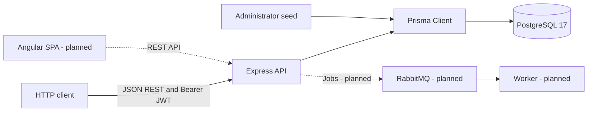
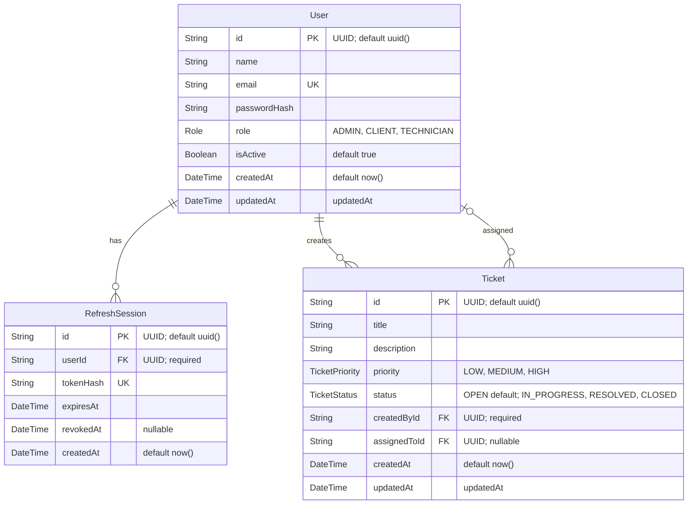

# Architecture

## Current components

The application is a JavaScript ESM Express REST backend connected through Prisma 6.19.3 to PostgreSQL 17. Docker Compose runs only PostgreSQL with a persistent named volume and health check. Express runs separately. CORS is configured for the intended frontend origin; the health endpoint checks HTTP availability only.

Angular and RabbitMQ are established technology choices but are not implemented. Ticket creation is implemented for CLIENT and ADMIN accounts (approved HU-07). There is no frontend, broker service, queue publisher, or worker. Dashed arrows below show planned integration, not existing runtime behavior.

No worker persistence, notification provider, or queue topology is decided by this diagram.

## Backend layout

| Path under `backend/` | Responsibility |
| --- | --- |
| `src/server.js` | Environment loading, Express/CORS/JSON setup, route mounting, health endpoint, parsing error handler, HTTP listener |
| `src/routes/` | Authentication, user, and ticket creation/read endpoints; middleware order |
| `src/controllers/` | Authentication/session business logic and direct Prisma user/ticket operations |
| `src/middleware/` | Bearer JWT authentication, current database account/role checks, administrator authorization, Zod validation adapter |
| `src/schemas/` | Zod body/parameter schemas; no environment validation |
| `prisma/` | Database schema, enums, initial and ticket migrations |
| `scripts/seed-admin.js` | Environment-configured, idempotent administrator creation with bcrypt hashing |
| `tests/` | Node test runner HTTP/database integration tests |

There is no service/repository layer. See the [backend README](../backend/README.md) for setup commands and [implementation records](ROADMAP.md) for historical verification.

## Database model

[backend/prisma/schema.prisma](../backend/prisma/schema.prisma) is the source of truth for database models. The initial migration creates User, RefreshSession, and Role; the HU-07 migration adds Ticket, TicketPriority, and TicketStatus. The ER diagram includes persisted scalar fields only; the Prisma relation fields `user` and `refreshSessions` are represented by the relationship.

A user can have zero or more sessions; every session belongs to one user. Both IDs use PostgreSQL UUID columns. Email and token hash are unique. The migration uses `ON DELETE RESTRICT` and `ON UPDATE CASCADE` for the foreign key. Ticket creator deletion is restricted; optional assignee deletion sets assignedToId to null. Both ticket foreign keys cascade updates. There are no queue tables.

## API and session flow

| Method | Route | Access/purpose |
| --- | --- | --- |
| POST | `/api/tickets` | CLIENT or ADMIN; create an OPEN, unassigned ticket owned by the authenticated user |
| GET | `/api/tickets` | Active account; list all (ADMIN), own (CLIENT), or assigned (TECHNICIAN) tickets |
| GET | `/api/tickets/:id` | Same visibility; missing or inaccessible tickets return 404 |
| GET | `/api/health` | Public HTTP health |
| POST | `/api/auth/login` | Public credential exchange for active accounts |
| POST | `/api/auth/refresh` | Refresh-token exchange |
| POST | `/api/auth/logout` | Revoke supplied refresh session |
| GET | `/api/users/me` | Any authenticated active role; own profile |
| POST | `/api/users` | ADMIN; create CLIENT or TECHNICIAN |
| GET | `/api/users` | ADMIN; list public user fields |
| PATCH | `/api/users/:id/deactivate` | ADMIN; deactivate another account |

1. Login validates request fields, finds an active user by exact email, and compares the bcrypt password hash. It returns basic user information, an HS256 access JWT (15 minutes, user ID and role claims), and a random opaque refresh token.
2. Refresh tokens contain 32 random bytes encoded as hex. Only SHA-256 hashes are stored, with expiration and optional revocation. Lifetime defaults to seven days via `REFRESH_TOKEN_EXPIRES_DAYS`.
3. Refresh checks session validity and active user status. A transaction conditionally revokes the old session and creates its replacement. Only one concurrent exchange can consume a token; replacements receive a fresh lifetime.
4. Protected routes verify the Bearer JWT signature, algorithm, expiration, and claims, then fetch the account from PostgreSQL. Missing/inactive accounts are rejected. Authorization uses the current database role, not a stale JWT role. ADMIN checks precede protected request-field validation.
5. Logout revokes only the supplied session. Unknown/already revoked tokens return an empty 204; previously issued access JWTs remain valid until expiration for otherwise active accounts. Deactivation blocks login, refresh, and protected routes. No access-token blacklist or session cleanup exists.

Zod validates request bodies/UUID parameters; field failures return 400 with `message` and `errors`. Malformed JSON is handled before Zod. Business errors retain simple message responses and appropriate 401/403/404/409/500 codes. Passwords/hashes and stored session hashes are excluded from API responses; plaintext tokens are returned only during issuance/exchange. User creation hashes passwords with bcrypt cost 12.

## Documentation boundaries

Earlier implementation notes describe their state at the time of each task. HU-02 added refresh tokens after HU-01; HU-05 added current-account authorization checks after HU-04; TASK-02 replaced manual request validation and changed malformed deactivation IDs to 400. Those later changes govern current behavior.

The [backend README](../backend/README.md) was reconciled with current authorization, request validation, and all existing API endpoints during TASK-03 final review. Setup and execution commands were unchanged.

Academic registration compliance and the proposed ticket/queue/frontend work are tracked in the [roadmap](ROADMAP.md). This document does not prescribe their future schema or detailed architecture.

Ticket creation uses strict Zod body validation (trimmed title: 1–200 characters; description: 1–5000; required priority enum). Authentication and current-role authorization precede validation. Only persisted ticket scalar fields are returned; server-owned fields and unknown body keys are rejected. HU-08 adds list/detail reads using a shared Prisma visibility filter applied in the database. Lists sort by createdAt descending, then id descending. Both reads include creator/assignee relations selecting only id, name, email, and role; absent assignees are null. Detail UUID validation follows authentication. Missing and inaccessible tickets share a 404 response. Updates, deletion, and jobs are not implemented. HU-08 is user-approved.
