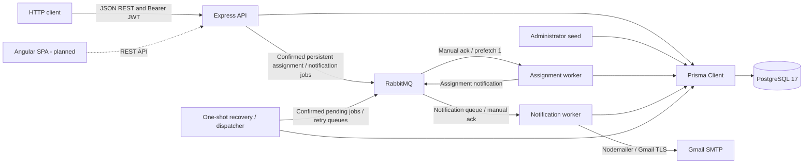
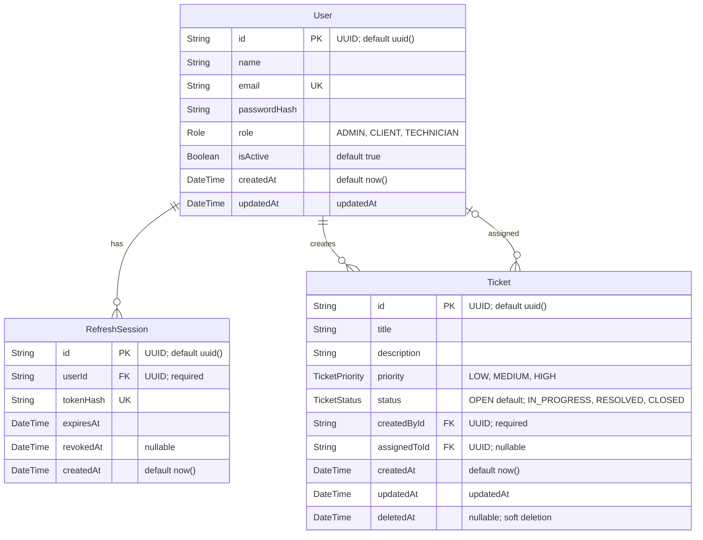
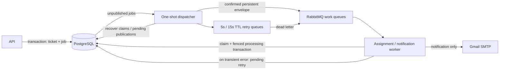
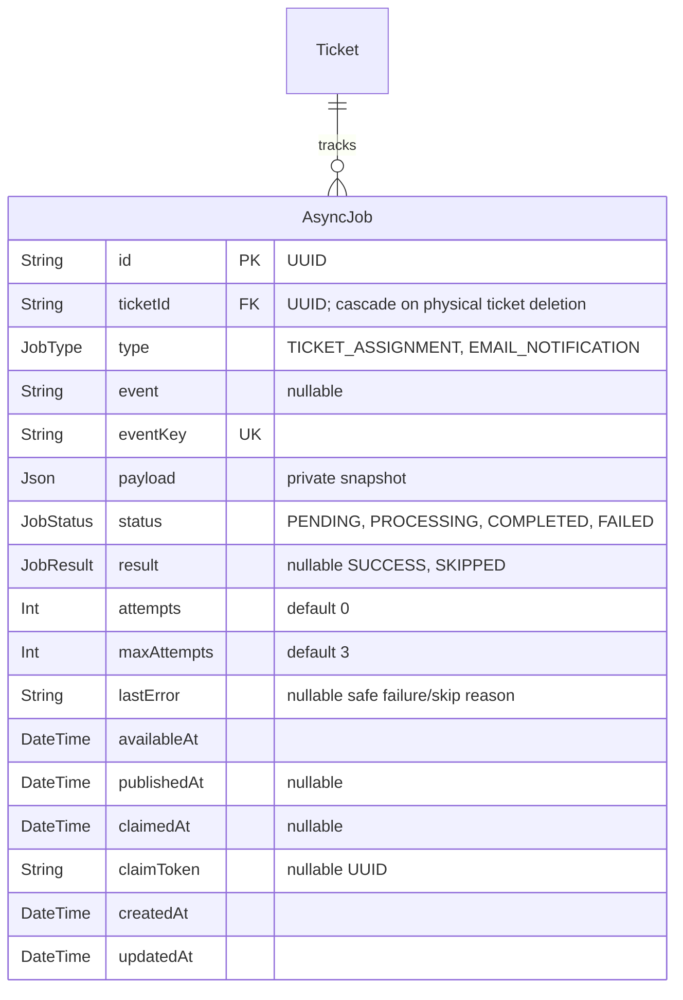

# Architecture

## Current components

The application is a JavaScript ESM Express REST backend connected through Prisma 6.19.3 to PostgreSQL 17. Docker Compose runs PostgreSQL and RabbitMQ 4.2 with persistent named volumes and health checks. Express runs separately. CORS is configured for the intended frontend origin; the health endpoint checks HTTP availability only.

Angular is planned; RabbitMQ assignment is implemented under HU-11. Ticket creation is implemented for CLIENT and ADMIN accounts (approved HU-07). There is no frontend. The API publishes assignment and notification messages; separate Node workers consume each queue. Dashed arrows below show planned integration, not existing runtime behavior.

Two durable classic work queues are used: priority queue `ticket-assignment` and independent `ticket-notification`, with 5/15-second TTL retry queues declared as needed. PostgreSQL AsyncJob stores job state and durable pending dispatch. Nodemailer sends via Gmail SMTP in the notification worker.

## Backend layout

| Path under `backend/` | Responsibility |
| --- | --- |
| `src/server.js` | Environment loading, Express/CORS/JSON setup, route mounting, health endpoint, parsing error handler, HTTP listener |
| `src/routes/` | Authentication, user, and ticket creation/read/update/deletion endpoints; middleware order |
| `src/controllers/` | Authentication/session business logic and direct Prisma user/ticket operations |
| `src/middleware/` | Bearer JWT authentication, current database account/role checks, administrator authorization, Zod validation adapter |
| `src/jobs/` | RabbitMQ queue declaration/publishing, assignment policy, notification templates/delivery handling and SMTP configuration |
| `src/workers/assignment.worker.js`, `src/workers/notification.worker.js` | Separate assignment and notification consumers with prefetch 1 and manual acknowledgements |
| `scripts/publish-assignment.js` | Persist/reuse and dispatch the assignment job for an existing ticket ID |
| `scripts/dispatch-jobs.js` | Recover stale claims and dispatch unpublished jobs |
| `src/schemas/` | Zod body/parameter schemas; no environment validation |
| `prisma/` | Database schema, enums, initial and ticket migrations |
| `scripts/seed-admin.js` | Environment-configured, idempotent administrator creation with bcrypt hashing |
| `tests/` | Node test runner HTTP/database integration tests |

There is no service/repository layer. See the [backend README](../backend/README.md) for setup commands and [implementation records](ROADMAP.md) for historical verification.

## Database model

[backend/prisma/schema.prisma](../backend/prisma/schema.prisma) is the source of truth for database models. The initial migration creates User, RefreshSession, and Role; the HU-07 migration adds Ticket, TicketPriority, and TicketStatus; the HU-10 migration adds nullable Ticket.deletedAt. The ER diagram includes persisted scalar fields only; the Prisma relation fields `user` and `refreshSessions` are represented by the relationship.

A user can have zero or more sessions; every session belongs to one user. Both IDs use PostgreSQL UUID columns. Email and token hash are unique. The migration uses `ON DELETE RESTRICT` and `ON UPDATE CASCADE` for the foreign key. Ticket creator deletion is restricted; optional assignee deletion sets assignedToId to null. Both ticket foreign keys cascade updates. HU-13 adds AsyncJob as durable job state and transactional dispatch storage (see below).

## API and session flow

| Method | Route | Access/purpose |
| --- | --- | --- |
| POST | `/api/tickets` | CLIENT or ADMIN; create an OPEN, unassigned ticket owned by the authenticated user |
| GET | `/api/tickets` | Active account; list all (ADMIN), own (CLIENT), or assigned (TECHNICIAN) tickets |
| GET | `/api/tickets/:id` | Same visibility; missing or inaccessible tickets return 404 |
| GET | `/api/tickets/:id/jobs` | Same visibility; safe job tracking array, newest first |
| PATCH | `/api/tickets/:id` | Same visibility; role/state-based partial updates under approved HU-09 |
| DELETE | `/api/tickets/:id` | Soft delete: CLIENT owns OPEN ticket; ADMIN any status; TECHNICIAN forbidden |
| GET | `/api/health` | Public HTTP health |
| POST | `/api/auth/login` | Public credential exchange for active accounts |
| POST | `/api/auth/refresh` | Refresh-token exchange |
| POST | `/api/auth/logout` | Revoke supplied refresh session |
| GET | `/api/users/me` | Any authenticated active role; own profile |
| POST | `/api/users` | ADMIN; create CLIENT or TECHNICIAN |
| GET | `/api/users` | ADMIN; list public user fields |
| PATCH | `/api/users/:id/deactivate` | ADMIN; deactivate another account |

1. Login validates request fields, finds the user by exact email, and compares the bcrypt password hash. Unknown emails and incorrect passwords return a generic 401. Only after password verification, an inactive account returns 403 with a deactivation message, without issuing tokens or creating a session. Successful login returns basic user information, an HS256 access JWT (15 minutes, user ID and role claims), and a random opaque refresh token.
2. Refresh tokens contain 32 random bytes encoded as hex. Only SHA-256 hashes are stored, with expiration and optional revocation. Lifetime defaults to seven days via `REFRESH_TOKEN_EXPIRES_DAYS`.
3. Refresh checks session validity and active user status. A transaction conditionally revokes the old session and creates its replacement. Only one concurrent exchange can consume a token; replacements receive a fresh lifetime.
4. Protected routes verify the Bearer JWT signature, algorithm, expiration, and claims, then fetch the account from PostgreSQL. Missing/inactive accounts are rejected. Authorization uses the current database role, not a stale JWT role. ADMIN checks precede protected request-field validation.
5. Logout revokes only the supplied session. Unknown/already revoked tokens return an empty 204; previously issued access JWTs remain valid until expiration for otherwise active accounts. Deactivation blocks login, refresh, and protected routes. No access-token blacklist or session cleanup exists.

Zod validates request bodies/UUID parameters; field failures return 400 with `message` and `errors`. Malformed JSON is handled before Zod. Business errors retain simple message responses and appropriate 401/403/404/409/500 codes. Passwords/hashes and stored session hashes are excluded from API responses; plaintext tokens are returned only during issuance/exchange. User creation hashes passwords with bcrypt cost 12.

## Documentation boundaries

Earlier implementation notes describe their state at the time of each task. HU-02 added refresh tokens after HU-01; HU-05 added current-account authorization checks after HU-04; TASK-02 replaced manual request validation and changed malformed deactivation IDs to 400. Those later changes govern current behavior.

The [backend README](../backend/README.md) was reconciled with current authorization, request validation, and all existing API endpoints during TASK-03 final review. Setup and execution commands were unchanged.

Academic registration compliance and the proposed ticket/queue/frontend work are tracked in the [roadmap](ROADMAP.md). This document does not prescribe their future schema or detailed architecture.

Ticket creation uses strict Zod body validation (trimmed title: 1–200 characters; description: 1–5000; required priority enum). Authentication and current-role authorization precede validation. Only persisted ticket scalar fields are returned; server-owned fields and unknown body keys are rejected. HU-08 adds list/detail reads using a shared Prisma visibility filter applied in the database. Lists sort by createdAt descending, then id descending. Both reads include creator/assignee relations selecting only id, name, email, and role; absent assignees are null. Detail UUID validation follows authentication. Missing and inaccessible tickets share a 404 response. Assignment messages are published under HU-11. HU-08 is user-approved.

HU-09 adds strict partial update validation using the creation field constraints and the existing status enum. Controller logic checks the persisted starting state before writing: CLIENT edits own OPEN content or closes own RESOLVED tickets; TECHNICIAN advances assigned tickets from OPEN to IN_PROGRESS and IN_PROGRESS to RESOLVED; ADMIN edits non-CLOSED content, performs normal forward transitions, or closes directly. CLOSED is terminal. Forbidden operations return 403 without partial writes. A Prisma transaction reads the visible ticket, conditionally updates against the starting status and visibility, and returns the same safe relations as detail reads. No models, migrations, assignment API, or new layers were added. HU-09 is user-approved.

HU-10 adds nullable Ticket.deletedAt through an additive migration. Normal list, detail, and update queries require deletedAt to be null alongside role visibility. DELETE preserves the row and status, sets deletedAt, and lets Prisma manage updatedAt. Missing, invisible, and already-deleted tickets return 404; visible but forbidden deletions return 403. Conditional writes recheck visibility, deletion state, and the CLIENT OPEN requirement. No restore, trash view, or new architectural layer is added. HU-10 is tested and user-approved; EP-02 backend ticket CRUD is complete.

## HU-11/HU-12 processing extended by HU-13 (user-approved)

Assignment policy and four notification recipients/templates remain unchanged. The API stores AsyncJob rows alongside committed ticket events. The assignment worker atomically writes the conditional assignment, its notification job and assignment-job completion. Notification payloads retain event-time snapshots privately in PostgreSQL. Existing queues retain their names/options; new persistent envelopes contain jobId, attempt generation and ticketId. LOW/MEDIUM/HIGH assignment priorities remain 1/2/3.

`src/jobs/async-jobs.js` implements unique event creation, outbox dispatch, conditional claims, bounded attempts, safe results/errors and stale recovery. `src/jobs/job-queue.js` publishes confirmed persistent envelopes and declares durable classic TTL/dead-letter retry queues (5/15 seconds). Workers use prefetch 1/manual acknowledgements. `scripts/dispatch-jobs.js` is a repeatable one-shot recovery/dispatch command, optionally invoked every minute by the OS scheduler. No new service/dependency is introduced. Existing low-level HU-11/HU-12 helpers remain for compatibility; application producers and workers use the tracked path.

AsyncJob's unique eventKey is ticket ID plus assignment type or notification event; approved terminal workflows permit each event once. Notification jobs persist a minimal private JSON snapshot. Job status is independent of ticket status. Public job API selects only safe tracking fields and applies existing non-deleted ticket visibility, newest first. See the [backend README](../backend/README.md) for the endpoint and operational commands.

Claims commit before work, incrementing attempts. Processing locks the row and verifies its token; assignment business effects and completion commit together. Retry state commits before publishing; envelopes contain the previous attempt count, preventing stale deliveries from consuming a later retry. Acknowledgements follow persisted outcomes. Recovery reopens claims after 120 seconds (or fails an exhausted claim) and permits republishing PENDING jobs after five minutes. An active row lock prevents stale recovery from overlapping the processing transaction. At most 100 pending jobs are dispatched per invocation.

There is no distributed transaction with RabbitMQ or SMTP. Confirmation/database gaps cause safe duplicate envelopes. SMTP acceptance before database completion can duplicate mail; SUCCESS means SMTP acceptance only. Recovery needs repeated command execution and manual worker restart after broker disconnect. Classic queue dead-lettering/storage failures can lose messages; pending republishing mitigates delivery loss while database state survives. SMTP processing holds a database transaction for up to 60 seconds. No exactly-once email, historical backfill, global job API or frontend is implemented. Legacy queued messages are adopted without purging; old and new workers must not run together. Full operational boundaries are documented in the README and HU-13 implementation record.
